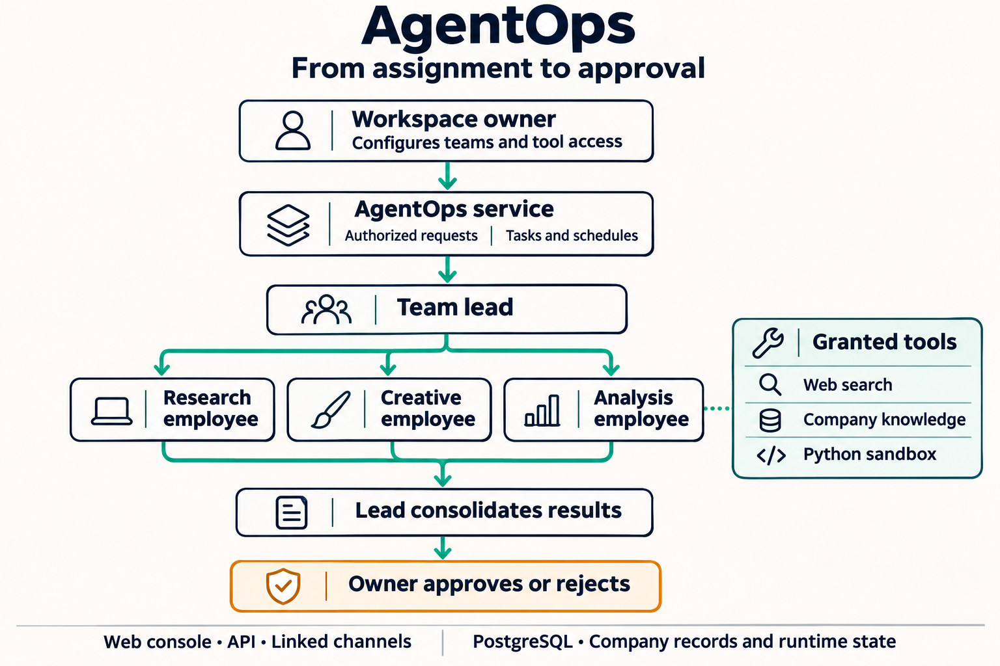

# AgentOps

**Run AI employees as a team, see who did the work, and keep release decisions with the workspace owner.**

AgentOps is a college research and showcase project for operating AI-powered companies. Create a workspace, configure AI employees with roles and tools, and assign work to an individual or a team. Review the result alongside the delegated assignments, tool activity, and approval decision.

[Try the hosted console](https://agentsops.onrender.com/) · [Run locally](#run-locally) · [Operations guide](docs/OPERATIONS.md)

## How work flows through AgentOps



1. **The workspace owner sets authority.** The owner manages membership, chooses the team lead and roster, configures providers, and grants tools to individual employees. Workspace members can submit tasks, start reviews, and chat with employees. Release decisions belong to the owner.
2. **The service routes work.** The authenticated API accepts direct and team assignments. The scheduler can dispatch either on a one-time or recurring schedule. Linked messaging channels connect an authorized sender to one configured employee.
3. **The team lead delegates and reviews.** The lead can ask employees on its roster for bounded pieces of work. Each employee uses its own tool grants. The lead reviews the results and assembles a final response. The task detail shows which handoffs actually ran and how they ended.
4. **The owner decides on a release brief.** A structured brief can enter a dedicated review workflow. The workflow pauses for approval or rejection and records the decision and reviewer. Approval records a decision inside AgentOps. Publishing and outbound campaign delivery are outside the current workflow.

## What you can do

| Workspace area | What it supports |
| --- | --- |
| **People and Teams** | Configure employees, assign tools, and choose who leads each team. |
| **Conversations and Office** | Chat with employees, submit team work from the team panel, and inspect activity. The Office visualizes recorded backend activity. |
| **Tasks and Workflows** | Assign background work, inspect worker results, schedule follow-ups, and review structured release briefs. |
| **Knowledge** | Upload text, Markdown, CSV, or text-based PDF files. Employees with access receive relevant excerpts from their company collection, with source and page or excerpt references. |
| **Settings** | Select a model, connect web search or a Python sandbox, and bind an employee to Telegram, Slack, Discord, or WhatsApp. Available connector tools depend on the provider and workspace configuration. |

## What makes AgentOps different

AgentOps centers the application around a **company and its people, agents, and authority**. The same employees and tool grants carry across conversations, assignments, and scheduled work. The evaluator can open a task, inspect individual handoffs, and see where a human decision was required.

| Solution | What it is designed for | What AgentOps brings to this use case |
| --- | --- | --- |
| **CrewAI** | Define collaborative crews and execution strategies with agents and tasks, including a hierarchical process. [CrewAI crews](https://docs.crewai.com/en/concepts/crews) | An operator can configure a persistent company roster, choose the lead, and inspect worker results from a workspace UI or API. |
| **LangGraph** | Build stateful agent graphs with explicit control flow, persistence, and interrupts. [LangGraph overview](https://docs.langchain.com/oss/javascript/langgraph/overview) | A ready-made organization model ties team assignments, per-employee tool grants, and owner review to workspace membership. |
| **n8n** | Connect apps through workflows and optionally require human review before AI tool calls. [n8n overview](https://docs.n8n.io/) · [Human review for tools](https://docs.n8n.io/build/integrate-ai/ai-examples/human-in-the-loop-for-tools.md) | The operator starts by assigning an outcome to a team. The lead chooses how to delegate within its roster, and the owner reviews the assembled brief. |

## Evaluator walkthrough

Use **The Reading Cup**, a fictional book café in Baner, Pune, to demonstrate one complete workflow. The original demo ran in **Northline Growth Studio** with Ananya Rao as lead, Arjun Mehta on research, Kavya Iyer on creative, Rohan Kulkarni on analysis, and Meera Nair on lifecycle copy.

1. In **People**, configure a strategy lead, researcher, creative specialist, analyst, and lifecycle specialist. Grant web search to the researcher and the Python sandbox to the analyst.
2. Ask the researcher to verify local comparable businesses against public sources. Ask the analyst to model three outcomes for a hypothetical ₹6,000 budget. Check cited pages and sandbox output before using the findings.
3. In **Tasks**, assign the team a **Release brief** for a 14-day campaign. Include the checked findings and ask the lead to delegate ad copy and an opt-in email draft. Expand **Delegations** to see which employees ran and read what they returned.
4. In **Workflows**, open the saved brief. Start review if needed and show **Awaiting approval**. The owner can record a decision after checking the draft.

## Run locally

You need Docker with Compose, a PostgreSQL database, a Supabase Auth project with a confirmed email/password user, and a model API key. Copy [.env.example](.env.example) to `.env`. Set `DATABASE_URL`, `SUPABASE_URL`, `SUPABASE_PUBLISHABLE_KEY`, and `MISTRAL_API_KEY` for the bundled deployment default. Keep provider and database credentials on the service.

From the repository root, build the service and apply the database migrations before startup.

```sh
docker compose build service
docker compose run --rm --no-deps service node scripts/migrate.mjs
docker compose up -d service
curl http://127.0.0.1:4111/healthz
```

On Windows PowerShell, use `curl.exe` for the health check. The authenticated API is under `/agentops/v1`. To add the optional web console, start the web profile and sign in at [localhost:3000](http://localhost:3000/).

```sh
docker compose --profile web up -d --build web
```

For a [headless task example](docs/OPERATIONS.md#run-one-task-from-powershell), [demo seeding](docs/OPERATIONS.md#seed-a-demo-company), provider configuration, and deployment instructions, see the [operations guide](docs/OPERATIONS.md).

## Architecture for developers

| Component | Responsibility |
| --- | --- |
| [Service](src/) | A standalone TypeScript and Mastra server owns authorization, agent execution, tools, channels, tasks, schedules, and review workflows. |
| [Web console](web/) | An optional Next.js client uses the authenticated API. The Phaser Office presents activity from that service. |
| [Data and migrations](db/) | Supabase Auth identifies callers. PostgreSQL separates company records in the `agentops` schema from Mastra runtime storage. |
| [Knowledge retrieval](src/knowledge.ts) | The service extracts and chunks documents at upload, ranks matching excerpts with PostgreSQL full-text search, and scopes the query to the company. |

Background executions are time-bounded. Review state persists in PostgreSQL, while an interrupted model call may require a new attempt. The operations guide covers hosting and schedule behavior, including server idle periods. [Mastra subagents](https://mastra.ai/docs/subagents) · [Workflow suspension and resumption](https://mastra.ai/docs/workflows/suspend-and-resume)

[Project guide](AgentOps_Project_Guide.md) · [Implementation plan](AgentOps_Implementation_Plan.md)
